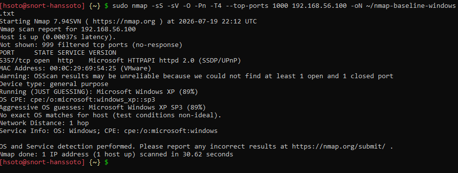

# Análisis del cliente Windows

**Objetivo:** `WIN-HANSSOTO` (Windows 10 Pro, 192.168.56.100)

## 1. Escaneo externo con Nmap (`-Pn`)
Se usó `-Pn` porque Windows bloquea el ping por defecto. Se lanzó desde `snort-hanssoto`:

```bash
sudo nmap -sS -sV -O -Pn -T4 --top-ports 1000 192.168.56.100 -oN ~/nmap-baseline-windows.txt
```

| Resultado | Valor |
|---|---|
| Puertos filtrados | 999 (no-response) |
| Puerto abierto | 5357/tcp – Microsoft HTTPAPI httpd 2.0 (SSDP/UPnP), servicio WSDAPI de descubrimiento de red |
| Detección de SO | No concluyente: "Microsoft Windows XP SP3 (89%)" como suposición; Nmap advierte que no encontró al menos un puerto abierto y uno cerrado |

Los 999 puertos filtrados muestran que el Firewall de Windows está activo y descarta el tráfico no solicitado. Que la detección del SO no sea concluyente es consecuencia de ese filtrado, y es una buena señal.



## 2. Auditoría local con PowerShell (como administrador)

```powershell
Get-MpComputerStatus | Select-Object AMRunningMode, AntivirusEnabled, RealTimeProtectionEnabled, AntivirusSignatureLastUpdated
Get-NetFirewallProfile | Select-Object Name, Enabled
Get-LocalUser | Select-Object Name, Enabled, PasswordRequired, LastLogon
Get-HotFix | Select-Object HotFixID, InstalledOn | Sort-Object InstalledOn -Descending | Select-Object -First 10
```

| Control | Resultado |
|---|---|
| Windows Defender | `AMRunningMode` Normal, `AntivirusEnabled` True, `RealTimeProtectionEnabled` True, firmas del 19/07/2026 |
| Firewall | Perfiles Domain, Private y Public: `Enabled = True` |
| Cuenta activa `WIN-HANSSOTO` | `Enabled = True`, **`PasswordRequired = False`** (se puede iniciar sesión local sin contraseña) |
| Parches | Los 6 HotFix listados (KB4517245, KB4528759, KB4528760, KB4532938, KB4513661, KB4516115) son del **09/01/2020**; no hay parches posteriores |

**Debilidades:** la cuenta local no exige contraseña, y el sistema queda expuesto a las vulnerabilidades publicadas después de enero de 2020.
