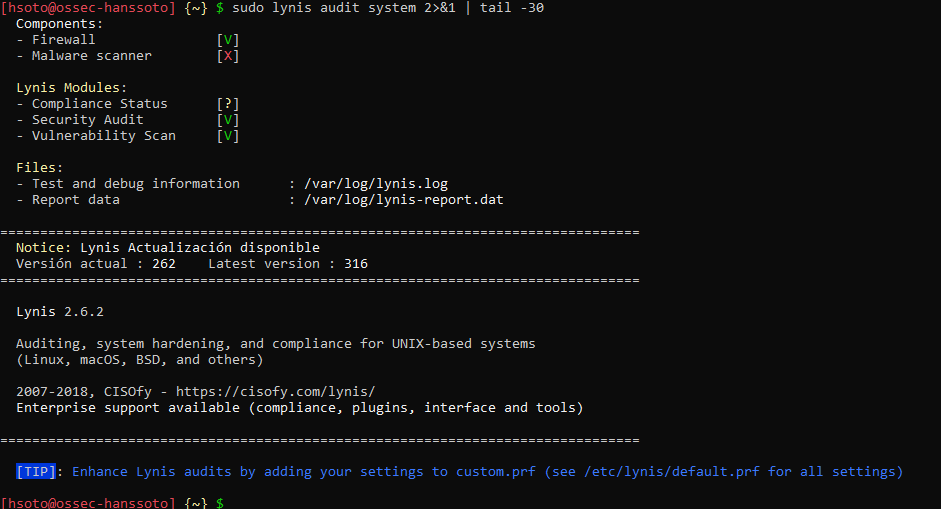

# Auditoría interna con Lynis (antes del hardening)

**Objetivo:** `ossec-hanssoto` (Ubuntu 18.04.6 LTS, 192.168.56.10)
**Herramienta:** Lynis 2.6.2, instalado con APT

```bash
sudo lynis audit system
```

## Resultado
| Métrica | Valor |
|---|---|
| Hardening index | **58 / 100** (línea base) |
| Advertencias | 4 |
| Sugerencias | 47 |

## Hallazgos clave
- **Firewall sin reglas activas** (iptables cargado sin reglas): control **FIRE-4512**. El escaneo Nmap lo confirma ([`nmap-externo.md`](nmap-externo.md)).
- **Sin política de contraseñas robusta**: hallazgos **AUTH-9262** (complejidad) y **AUTH-9286** (expiración).
- **Modo de usuario único sin contraseña.**
- **Varias mejoras pendientes en la configuración de SSH.**
- **Apache activo**: es un servicio innecesario en un servidor OSSEC y amplía la superficie de ataque. Se deshabilitó en la Actividad 2 ([`../02-hardening/lynis-despues.md`](../02-hardening/lynis-despues.md)).

## Evidencia


> Nota: esta captura muestra el final de la salida de la auditoría inicial, pero el índice 58 no aparece en ella. La cifra 58 está en el texto del informe y también en la comparación de [`lynis-despues.md`](../02-hardening/lynis-despues.md).
