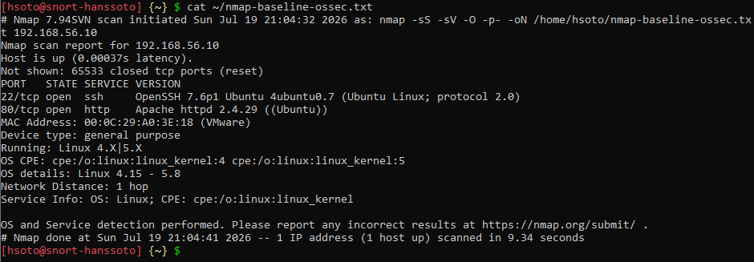

# Escaneo externo con Nmap (servidor Linux)

**Origen:** `snort-hanssoto` (192.168.56.20)
**Objetivo:** `ossec-hanssoto` (192.168.56.10)

El escaneo combina SYN sigiloso, detección de versiones, detección de sistema operativo y barrido de los 65 535 puertos, para simular lo que vería un atacante desde la red:

```bash
sudo nmap -sS -sV -O -p- 192.168.56.10
```

La captura muestra la misma ejecución guardada con `-oN ~/nmap-baseline-ossec.txt`.

## Resultado (Nmap 7.94SVN)
| Puerto | Estado | Servicio | Versión |
|---|---|---|---|
| 22/tcp | open | ssh | OpenSSH 7.6p1 Ubuntu 4ubuntu0.7 (protocol 2.0) |
| 80/tcp | open | http | Apache httpd 2.4.29 ((Ubuntu)) |

- 65 533 puertos en estado `closed` (reset). Que todos respondan *cerrado* en vez de *filtrado* confirma que no hay firewall activo, igual que el hallazgo **FIRE-4512** de Lynis.
- SO detectado: Linux 4.15 - 5.8 (1 salto).
- Duración: 9,34 s.



## Reporte de vulnerabilidades y vectores de ataque
| Puerto / servicio | Versión | Vector de ataque identificado |
|---|---|---|
| 22/TCP – SSH | OpenSSH 7.6p1 | Fuerza bruta de credenciales; puerto estándar expuesto a bots automatizados; sin límite de intentos ni bloqueo. |
| 80/TCP – HTTP | Apache 2.4.29 | Servicio innecesario en un servidor OSSEC; superficie web expuesta sin WAF ni módulos de protección. |
| Firewall | Inexistente | Sin reglas activas: todos los puertos son alcanzables desde la red. |
| Contraseñas | Sin política | Sin complejidad ni expiración; riesgo de credenciales débiles. |
