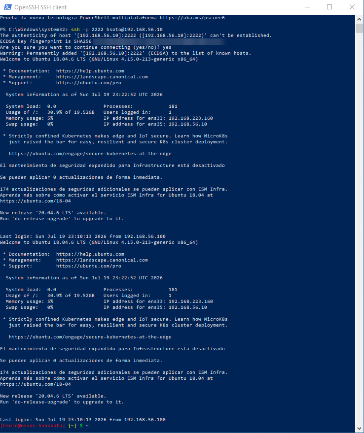
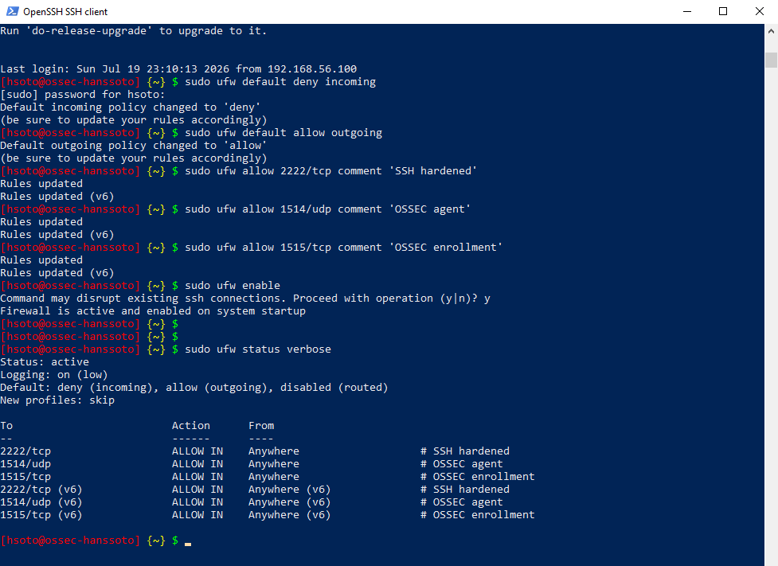
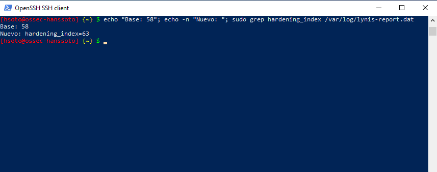

# Controles aplicados y Lynis después del hardening

**Objetivo:** `ossec-hanssoto` (192.168.56.10)

## Controles aplicados

### 1. Deshabilitar servicios innecesarios (Apache)
```bash
sudo systemctl stop apache2
sudo systemctl disable apache2
```
Al verificar se confirmó que el puerto 80 ya no estaba en escucha.

### 2. SSH endurecido
Configuración en [`ssh/sshd_config.hardened`](ssh/sshd_config.hardened): `Port 2222`, `PasswordAuthentication no` (solo claves ed25519) y `PermitRootLogin no`. Cada cambio se validó con `sudo sshd -t` antes de reiniciar el servicio, y la conexión por el 2222 se probó antes de cerrar la sesión anterior.



### 3. Firewall UFW
Script en [`ufw/reglas.sh`](ufw/reglas.sh): entrada denegada y salida permitida por defecto; solo se abren 2222/tcp (SSH), 1514/udp (agente OSSEC) y 1515/tcp (registro de agentes OSSEC).



### 4. Política de contraseñas
- **Complejidad** (`libpam-pwquality`): ver [`pam/common-password.snippet`](pam/common-password.snippet). Corrige **AUTH-9262**.
- **Expiración** (`/etc/login.defs`): `PASS_MAX_DAYS 90`, `PASS_MIN_DAYS 7`, `PASS_WARN_AGE 14`. Como `login.defs` solo afecta a los usuarios nuevos, también se aplicó a la cuenta `hsoto` con `chage` (verificado con `chage -l`). Corrige **AUTH-9286**.
- **Auditoría con John the Ripper**: se combinaron `/etc/passwd` y `/etc/shadow` con `unshadow` y se lanzaron un ataque de diccionario con reglas y uno de fuerza bruta incremental. Tras varios minutos no se rompió ninguna de las dos contraseñas activas (`root` y `hsoto`). Los hashes son SHA-512, a unos 730 intentos/segundo.

## Resultado de Lynis
```bash
sudo lynis audit system
echo "Base: 58"; echo -n "Nuevo: "; sudo grep hardening_index /var/log/lynis-report.dat
```

| Antes | Después |
|---|---|
| 58 (valor del informe académico; la captura inicial no se conserva) | **63** (medido en captura) |



La subida de 58 a 63 refleja los controles críticos aplicados: SSH endurecido, firewall activado, servicios innecesarios deshabilitados y políticas de contraseñas.
