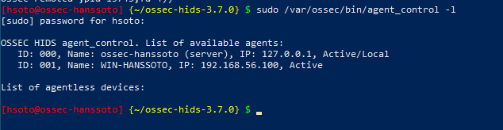

# Registro del agente Windows

| Dato | Valor |
|---|---|
| Servidor | `ossec-hanssoto`, 192.168.56.10 |
| Agente | `WIN-HANSSOTO`, 192.168.56.100 (Windows 10 Pro) |
| Versión del agente | OSSEC 3.7.0 para Windows |

## 1. En el servidor: alta del agente y extracción de la clave
```bash
sudo /var/ossec/bin/manage_agents
# (A) Add an agent    -> nombre: WIN-HANSSOTO, IP: 192.168.56.100
# (E) Extract key     -> copiar la clave en base64 generada para el agente
sudo /var/ossec/bin/ossec-control restart
```

> **Aviso de seguridad:** la clave de autenticación (base64) vincula al agente con el servidor. **No se publica.** No hay capturas de `manage_agents` en este repositorio.
>
> ```
> <CLAVE_DEL_AGENTE_NO_PUBLICADA>
> ```

## 2. En el cliente Windows
1. Instalar el agente OSSEC 3.7.0 como administrador.
2. En **OSSEC Agent Manager**, poner la IP del servidor (`192.168.56.10`) y pegar la clave extraída.
3. Guardar y reiniciar el servicio del agente.

## 3. Verificación en el servidor
```bash
sudo /var/ossec/bin/agent_control -l
```

Resultado:
```
ID: 000, Name: ossec-hanssoto (server), IP: 127.0.0.1, Active/Local
ID: 001, Name: WIN-HANSSOTO, IP: 192.168.56.100, Active
```



## Despliegue de EV2 (Fase B)
En EV2 el agente se registró como `windows-cliente` con IP `192.168.100.200` (ID 001), y en el agente se configuró como *OSSEC Manager IP* la dirección `192.168.100.1` (el firewall Ubuntu en la LAN). Se siguió el mismo procedimiento con `manage_agents`.
