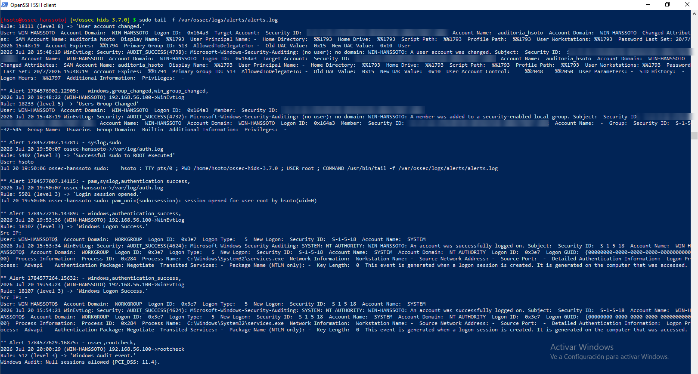
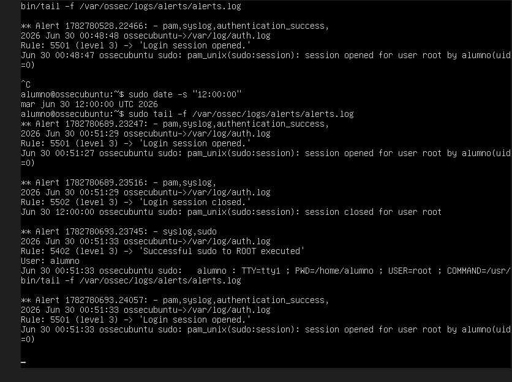
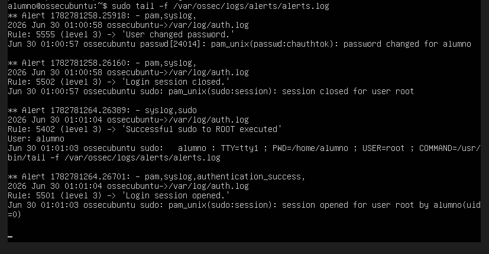

# Alertas probadas en OSSEC

## Prueba 1 (Hardening): creación de un usuario en Windows

En `WIN-HANSSOTO` se creó el usuario **`auditoria_hsoto`**. El agente reenvía al servidor los eventos del registro de seguridad de Windows, y el servidor los clasifica.

Monitoreo en el servidor:
```bash
sudo tail -f /var/ossec/logs/alerts/alerts.log
```

| Regla | Nivel | Descripción en `alerts.log` | Evento de Windows | Detalle |
|---|---|---|---|---|
| **18111** | **8** | `User account changed.` | 4738 | Generada al crear el usuario `auditoria_hsoto` |
| **18233** | 5 | `Users Group Changed` | 4732 | Se añadió un miembro al grupo local `Usuarios` (Builtin) |
| **18107** | 3 | `Windows Logon Success.` | 4624 | Inicios de sesión de `SYSTEM` (`services.exe`), tipo 5 |
| 5402 | 3 | `Successful sudo to ROOT executed` | — | `sudo tail -f .../alerts.log` en el servidor |
| 5501 | 3 | `Login session opened.` | — | `pam_unix(sudo:session)` en el servidor |
| 512 | 3 | `Windows Audit event.` | — | rootcheck: `Null sessions allowed {PCI_DSS: 11.4}` |

La regla 512 muestra que OSSEC mapea automáticamente sus hallazgos de rootcheck a estándares de cumplimiento (PCI-DSS 11.4).



## Prueba 2 (EV2): alertas por cambio de hora y de contraseña

Las dos pruebas se hicieron en el propio servidor OSSEC, el firewall Ubuntu `ossecubuntu`, y se monitorearon con `sudo tail -f /var/ossec/logs/alerts/alerts.log`.

**Cambio de hora.** La captura muestra `sudo date -s "12:00:00"` ejecutado en `ossecubuntu`. Después aparecen las alertas 5501 (`Login session opened.`), 5502 (`Login session closed.`, con la hora del log ya en `12:00:00`) y 5402 (`Successful sudo to ROOT executed`), todas de nivel 3 y con origen `/var/log/auth.log`.



**Cambio de contraseña.** Regla **5555** (nivel 3), `User changed password.`, a partir de `passwd[24014]: pam_unix(passwd:chauthtok): password changed for alumno` en `/var/log/auth.log` de `ossecubuntu`. Le siguen 5502, 5402 y 5501.


