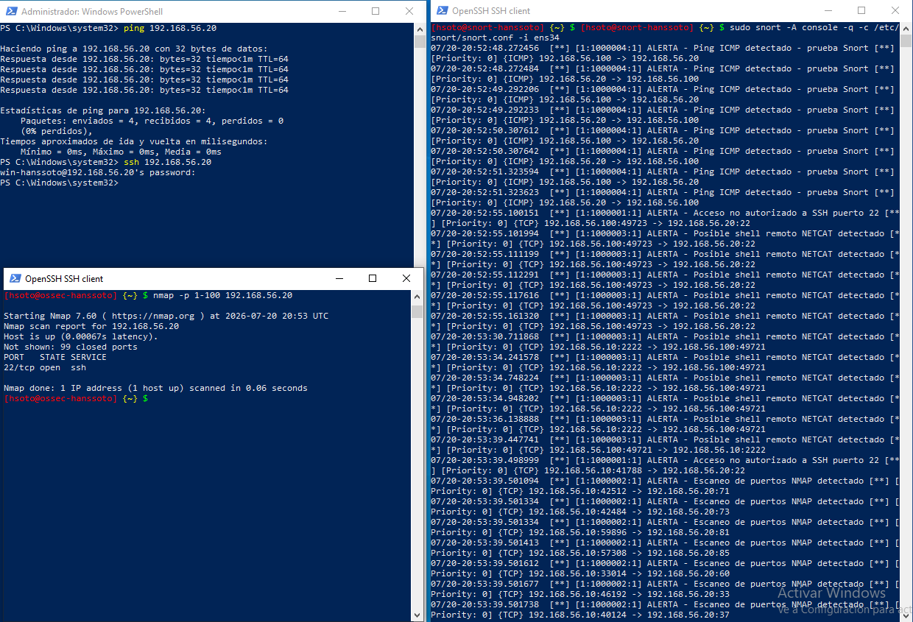

# Snort: configuración y pruebas de detección

**Sensor:** `snort-hanssoto` (Ubuntu 24.04.2 LTS, 192.168.56.20)
**Versión:** Snort 2.9.20, instalado con APT

## Configuración
- `HOME_NET` = `192.168.56.0/24` (definida en la instalación y fijada después en `snort.conf`).
- Interfaz de escucha: `ens34`, el adaptador conectado a la red Host-Only.
- Antes de crear las reglas se probó la captura en modo sniffer generando tráfico ICMP. Se vio el tráfico SSH, DNS y el del agente OSSEC.
- Reglas propias en `/etc/snort/rules/local.rules` (ver [`local.rules`](local.rules)).

```bash
sudo snort -T -c /etc/snort/snort.conf     # cargó las 4 reglas sin errores de sintaxis
```

| SID | Regla | Detección |
|---|---|---|
| 1000001 | Acceso SSH puerto 22 | Paquetes SYN dirigidos al puerto 22: intentos de conexión SSH no autorizados. |
| 1000002 | Escaneo NMAP | Más de 20 paquetes SYN desde un mismo origen en 3 segundos: patrón de escaneo de puertos. |
| 1000003 | Shell remoto Netcat | Patrón de bytes nulos propio de sesiones de shell binarias como Netcat. |
| 1000004 | Ping ICMP (prueba) | Paquetes ICMP echo, para validar el motor de reglas. |

## Pruebas
Snort en modo detección con alertas por consola:
```bash
sudo snort -A console -q -c /etc/snort/snort.conf -i ens34
```

Tráfico generado (según la captura):

| Prueba | Origen | Comando | Regla que se disparó |
|---|---|---|---|
| Ping ICMP | `WIN-HANSSOTO` (192.168.56.100), PowerShell | `ping 192.168.56.20` (4 enviados, 4 recibidos) | **1000004**: `ALERTA - Ping ICMP detectado - prueba Snort` |
| Intento SSH | `WIN-HANSSOTO` (192.168.56.100), PowerShell | `ssh 192.168.56.20` | **1000001**: `ALERTA - Acceso no autorizado a SSH puerto 22` (192.168.56.100:49723 → 192.168.56.20:22), seguida de **1000003** |
| Escaneo de puertos | `ossec-hanssoto` (192.168.56.10) | `nmap -p 1-100 192.168.56.20` (Nmap 7.60; 22/tcp open, 99 closed) | **1000001** y una cascada de **1000002**: `ALERTA - Escaneo de puertos NMAP detectado` hacia los puertos sondeados |

Las 4 reglas se dispararon. La regla de escaneo genera una cascada de alertas por los muchos puertos sondeados en el mismo instante, que es la firma típica de un escaneo real.



## Falsos positivos observados
La regla 1000003 (Netcat), que busca el byte nulo, también salta con tráfico binario legítimo. En la captura se dispara con el intento SSH al 22 y con la sesión SSH cifrada entre `192.168.56.10:2222` y `192.168.56.100:49721`. En producción habría que afinarla con patrones adicionales.

> Nota: el texto del informe dice que todo el tráfico de prueba salió de `ossec-hanssoto`. La captura muestra que el ping y el intento SSH se lanzaron desde el cliente Windows (192.168.56.100) y solo el Nmap desde `ossec-hanssoto`. Aquí se describe lo que muestra la captura.
