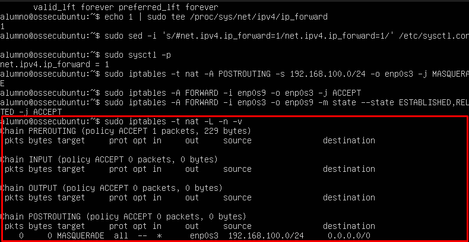
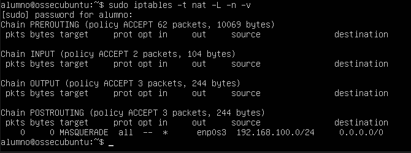

# Topología y pruebas del firewall iptables (EV2)

Laboratorio en Oracle VirtualBox. Un firewall Ubuntu con tres adaptadores hace de router entre las zonas WAN, DMZ y LAN.

```
Internet ── enp0s3 (WAN, NAT) ── [Firewall Ubuntu] ── enp0s8 (DMZ 192.168.56.1/24) ── Metasploitable 192.168.56.200
                                       └── enp0s9 (LAN 192.168.100.1/24) ── Windows 192.168.100.200
```

| Interfaz | Adaptador | Zona | IP |
|---|---|---|---|
| `enp0s3` | NAT | WAN / Internet | DHCP de VirtualBox (10.0.2.15/24) |
| `enp0s8` | Solo Anfitrión | DMZ | 192.168.56.1/24 estática |
| `enp0s9` | Red interna | LAN | 192.168.100.1/24 estática |

Equipos: Metasploitable `192.168.56.200/24` (DMZ) y cliente Windows `192.168.100.200/24` con gateway `192.168.100.1` (LAN).

Script completo: [`firewall.sh`](firewall.sh).

## Políticas
| Cadena | Inicial | Configurada |
|---|---|---|
| INPUT | ACCEPT | **DROP** |
| FORWARD | ACCEPT | **DROP** |
| OUTPUT | ACCEPT | ACCEPT |

## NAT / MASQUERADE (LAN → Internet)
Se activa `net.ipv4.ip_forward = 1` y se crea la regla `MASQUERADE` de `192.168.100.0/24` hacia `enp0s3`.





## SSH solo desde la LAN
```bash
sudo iptables -L INPUT -n -v --line-numbers
```
| # | Objetivo | Prot | In | Origen | Condición |
|---|---|---|---|---|---|
| 1 | ACCEPT | all | lo | 0.0.0.0/0 | |
| 2 | ACCEPT | all | enp0s3 | 0.0.0.0/0 | state RELATED,ESTABLISHED |
| 3 | ACCEPT | tcp | enp0s8 | 0.0.0.0/0 | tcp dpt:22 |
| 4 | ACCEPT | tcp | enp0s9 | 192.168.100.0/24 | tcp dpt:22 |
| 5 | DROP | tcp | * | 0.0.0.0/0 | tcp dpt:22 |

> Nota: la regla 3 (SSH aceptado por `enp0s8`, la DMZ) aparece en la captura, pero el comando que la creó no está en el informe. Con ella, el SSH también se acepta desde la DMZ.


Desde el Windows de la LAN (192.168.100.200) la conexión SSH con PuTTY funcionó. Desde un equipo fuera de `192.168.100.0/24`, el intento `ssh alumno@192.168.100.1` termina en `Connection timed out`:


## ICMP entre LAN y DMZ
Las reglas `FORWARD` permiten ICMP en ambos sentidos entre `enp0s9` (LAN) y `enp0s8` (DMZ).


